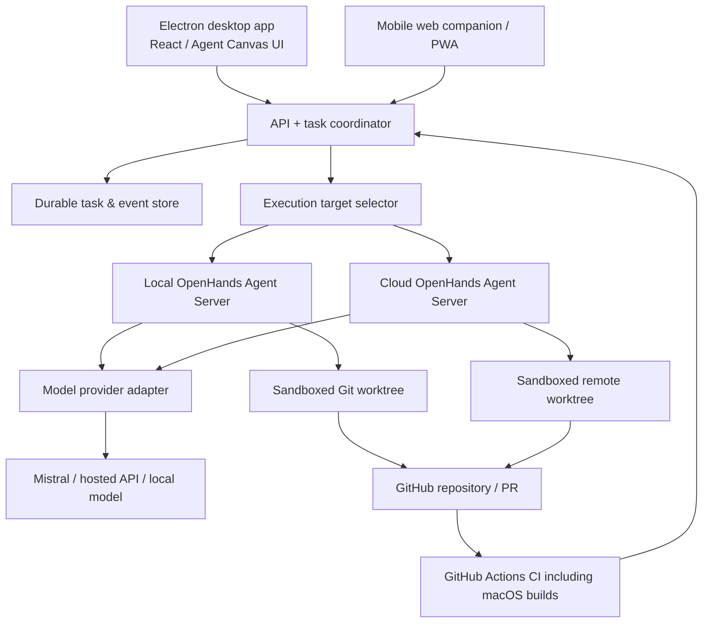

# AI Developer Studio — Master Build Plan

**Version:** 1.0 — Planning baseline, October 31, 2026  
**Status:** Proposed; engineering validation required before committing to milestones  
**Product:** Standalone Cursor-style editor + Codex-style autonomous coding studio  
**Platform order:** Windows/macOS desktop → browser-based iPhone companion → optional native iOS  
**Foundation:** OpenHands Agent Canvas and Software Agent SDK  
**Audience:** Product owner, engineering team, AI-agent developers, QA/security

---

## 0. Executive decision

Fork the active `OpenHands/OpenHands` Agent Canvas codebase and use the OpenHands Agent Server / Software Agent SDK as the primary coding execution framework. Retain the existing React/TypeScript UI, Electron packaging, event/client interfaces, automation primitives, and existing OpenVSCode editor integration where they meet requirements. Customize the shell and workflows, do not rewrite the engine or create a new IDE by default.

Build a **unified workflow** with three adjacent modes:

1. **Editor** — Cursor-style file exploration, coding, diagnostics, terminal, inline edits, diffs and manual debugging.
2. **Agents** — Codex-style agent conversations and bounded autonomous tasks, with isolated branches/worktrees, visible plans, tests and results.
3. **Review** — See patch, test output, commands, security checks, approvals and PR actions before accepting work.

Build a **remote worker path** to continue work when desktop machines are offline. Treat a remote agent run and a local agent run as separate processes sharing durable tasks, Git branches and explicit checkpoints. A local in-memory process cannot transparently teleport to another computer.

### Fixed architectural decisions

- **Source of truth:** Git repositories for code, task database/event log for execution state; do not store secrets in either.
- **Agent execution:** OpenHands Agent Server. Add LangGraph only if real multi-step orchestration needs cannot be handled cleanly by an explicit workflow service plus the existing SDK.
- **Desktop shell:** Electron first; defer Tauri migration until packaging/operational data justify it.
- **Editor:** Assess the bundled OpenVSCode first. If embedding, isolation, and UX are inadequate, benchmark a Monaco-based alternative rather than assuming a rewrite.
- **Models:** Provider adapters with Mistral as an initial option; open to OpenAI, other hosted providers and a local Ollama-compatible endpoint. Do not hard-wire one provider.
- **Remote:** Self-hosted Linux worker (Docker/container sandbox) and secure web access; GitHub Actions for CI/build/test jobs, **not** a permanent agent runtime.
- **iOS:** Responsive web companion/PWA first. Native app only if push, sharing, offline features or device integration materially demand it.
- **Scope:** Single-user, private-beta-quality first; enterprise/team features later.

### Non-goals for the first release

- Pixel-perfect clone of Cursor or Codex.
- Full debugger ecosystem and marketplace compatibility from day one.
- A multi-tenant SaaS billing platform.
- Fully automated deployment or production merges without explicit approval.
- Reimplementing OpenHands tools, terminal, workspace management or authentication unless necessary.
- LLM hosting on the VPS initially; use API models, with local inference as a selectable backend.

---

## 1. Success criteria and user journeys

### Journey A — Interactive coding

1. Open a local or GitHub project.
2. Navigate files in a clean file explorer and editor.
3. Select code, ask a question or request an edit.
4. See a preview diff; accept/reject individual hunks.
5. Run tests or commands, inspect output, revert safely.
6. Commit to a branch and open a PR.

### Journey B — Autonomous implementation

1. Select a project, branch/base commit, model, execution target and cost ceiling.
2. Submit a feature/bug request.
3. Agent inspects scoped repository, proposes a plan, and starts within configured permissions.
4. Agent works in its own Git worktree or container, streams trace/commands/results.
5. Automated tests, static checks and a reviewer run.
6. User reviews changes, requests adjustments, or opens PR. Nothing merges autonomously by default.

### Journey C — Parallel multi-agent development

1. Lead agent decomposes the request into tasks, dependencies and acceptance criteria.
2. Independently scoped implementation agents work on isolated branches/worktrees.
3. QA/reviewer checks output; conflicting changes are surfaced.
4. Integration agent combines approved work in dependency order, reruns tests and requests review.

### Journey D — Desktop offline / iPhone online

1. The user submits a task from iPhone while Mac is unavailable.
2. A protected remote backend clones/updates an authorized GitHub repo and runs the task.
3. The user views progress, approvals, logs and changed files on mobile.
4. After reconnecting on desktop, the same task record and remote Git branch can be opened.
5. Unsynced local changes are never silently overwritten; conflicts require an explicit resolution.

### Journey E — iOS projects

1. A Linux worker can inspect, refactor and test portable code/tooling where supported.
2. Xcode and iOS-specific build/test steps run on a macOS runner or Mac with Xcode, not on Linux.
3. Build artifacts and test diagnostics return to the central task record; signing credentials are kept in a secure CI secret store.

### Measurable launch gates

- Create and open a project from GitHub, edit, run a test, and open a PR without using an external editor.
- 100% of agent writes occur in an authorized workspace/branch, not an unrestricted host path.
- Agent failures and desktop/network disconnects leave a recoverable state with no silent data loss.
- Every autonomous change includes an inspectable diff, commands performed, model/provider usage, and tests/run status.
- Mac/Windows app launches cleanly and reconnects to existing task history.
- Browser companion can create tasks, view results and approve/deny high-risk actions over an authenticated connection.
- Passing CI and security gate before private beta.

---

## 2. Reference architecture



### A. Desktop client

- Electron as first-party app shell, minimize unnecessary Chromium instances and background processes.
- Reuse Agent Canvas routing, UI primitives, React Query / Zustand state, and existing TypeScript Agent Server client.
- Add top-level **Editor / Agents / Review** navigation and a compact project switcher.
- Editor should support tabs, file navigation, search, problems, terminal, code selection, inline commands and diff review.
- Keep terminal, advanced logs, model selectors and preferences accessible but collapsed by default.
- Platform-native window chrome, shortcuts, contextual menus, safe filesystem dialogs, and light/dark themes.

### B. Agent server and worker

- Reuse upstream Agent Server API and Software Agent SDK wherever possible.
- Local mode: explicit sandboxed project directories; no raw host-wide filesystem access.
- Remote mode: isolated task containers (or stronger isolation if threat model warrants), non-root UID, CPU/RAM/disk/time budgets, scoped network and repository access.
- Each autonomous task references a Git ref/base SHA and owns a worktree or isolated checkout.
- No direct production credential access or unrestricted Docker socket mounts.
- Stream trace events, command outputs, file changes, test status and checkpoints.
- Support pause/cancel/retry with idempotent task IDs and bounded retries.

### C. Task coordinator

Implement only the missing product-wide orchestration layer; avoid a second competing autonomous agent engine. Owns:

- Task lifecycle and state machine: `created → planning → needs_approval → queued → running → verifying → review_ready → complete`, with `blocked`, `failed`, `cancelled` branches.
- Durable project/task/session metadata and event IDs.
- Assignment and rehydration to compatible local or remote workers.
- Permission policies, budget caps, timeout handling and routing priorities.
- Task dependency graph and merge queue (later milestone).
- Reconnection/replay; clients subscribe to ordered event streams and fetch missed events by cursor.

### D. Persistence

- **Initially:** rely on OpenHands canonical conversation persistence; add a small SQLite task store for local-only metadata if needed, after reviewing existing schemas.
- **Cloud:** durable Postgres or other managed DB when multi-device state requires it, plus object/artifact storage for logs and patches.
- **Git remains the code authority:** commit/push changes to a task branch before migrating execution targets.
- Project context should be versioned documents and compact indexed metadata, not an uncontrolled dump of all agent conversations.
- Use explicit schema migration and backups. Secrets in OS keychain / encrypted server secret store only.

### E. Model adapter

- Model registry: provider, model, endpoint, context limits, tool-use support, pricing, max tokens, latency and enabled status.
- User can set default **Plan / Implement / Review** models, and cost/latency modes.
- Initial hosted provider may be Mistral. Validate tool-calling, structured outputs, patch accuracy and cost on our real coding tasks.
- Fallback to another provider is **opt-in** for private code. Warn when a request would send repository content to a newly selected service.
- Local models via Ollama/OpenAI-compatible endpoint are optional; validate quality independently of whether they fit on hardware.

### F. GitHub integration

- GitHub App for long-lived product integration; OAuth where it fits interactive sign-in. Least-privilege, repository-scoped access, short-lived credentials when possible.
- Clone/import, repository list, branch and PR view, issue links, status checks and review requests.
- Create branch naming convention: `agent/<task-id>-<slug>`.
- Every PR includes task summary, file list, tests, security notes, risks, manual review status and trace link.
- GitHub Actions for lint/unit/build/test, macOS/Xcode validation for iOS projects. No agent secrets in PRs or logs.

### G. Mobile companion

- PWA responsive UI, not the full desktop editor squeezed onto a phone.
- Main tabs: Projects, Tasks, Activity, Review, Settings.
- Create, pause/cancel and follow a remote task; inspect summaries, diffs, checks and approvals.
- Resume from cursor after network disconnect. Mobile read-only terminal logs initially; dangerous commands require fine-grained approval.
- Passkeys or secure SSO, short-lived sessions, optional biometrics via platform support later.

---

## 3. UI/UX specifications

### Three primary views

**Editor:** Left collapsible file/branch navigator; center editor with code tabs; right contextual AI chat/task panel; bottom optional terminal/problems/output drawer. Adjustable splits, keyboard shortcuts, distraction-free mode.

**Agents:** Conversation/task feed, parallel jobs, plan + steps, progress and blockers, per-agent permissions/model/cost, artifacts, logs. Use one clear current-task surface instead of many stacked dashboards.

**Review:** File-by-file and hunk-by-hunk diff, checks and test summary, warnings, comments, allow edits/request rework/commit/push/create PR. No “one click approve all” on high-risk actions.

### Visual language

- Minimal, ChatGPT-inspired shell with Cursor-grade density in the actual editor.
- Thin dividers, subtle translucent overlays only when platform performance allows, restrained elevation, consistent spacing/typography.
- Responsive navigation, 2-pane max by default; advanced panels are opt-in.
- Command palette and keyboard-first navigation, touch-friendly mobile surfaces.
- Accessible contrast, logical focus order, keyboard accessibility and reduced-motion settings.
- Design tokens rather than broad ad hoc CSS overrides; upstream CSS scoped for embedding.

### Design deliverables

- Figma or coded design tokens for colors, typography, spacing, icons, density and breakpoints.
- State layouts for: empty/no repo, loading, planning, running, approval needed, error, completed, offline, reconnecting.
- Component inventory: project switcher, sidebar, agent cards, task progress, diff browser, approvals, model chooser, terminal, notification center.
- Desktop Windows/macOS + narrow-screen iPhone prototype with usability walkthroughs.

---

## 4. Implementation phases and issue checklists

> Planning sequence, not a delivery promise. Complete each gate before expanding scope.

### Phase 0 — Technical due diligence and feasibility **[P0]**

**Goal:** Confirm that the proposed stack is buildable before committing to a fork.

- [ ] `P0-01` Inventory the current upstream releases, package boundaries, SDK/client API versions and desktop build dependencies.
- [ ] `P0-02` Review all direct/transitive licenses, attribution, brand/trademark usage and commercial distribution implications.
- [ ] `P0-03` Run unmodified Agent Canvas locally on Windows and macOS if hardware is available; record setup friction and baseline performance.
- [ ] `P0-04` Verify a GitHub repo import, source file edit, AI coding task, terminal command, test, diff and PR path end-to-end.
- [ ] `P0-05` Test existing OpenVSCode embed/interaction and document security isolation issues; decide reuse versus limited Monaco fallback.
- [ ] `P0-06` Prototype Mistral tool use and benchmark against at least one other hosted model on 10 realistic coding tasks.
- [ ] `P0-07` Test agent server on a secured Linux VM, then connect from desktop/browser.
- [ ] `P0-08` Create architecture decision records (ADRs): shell, editor, SDK integration, remote worker, persistence and auth.
- [ ] `P0-09` Record baseline CPU/RAM/startup usage and stability.

**Gate:** One complete task works on an unchanged baseline; clear extension points and blocker list documented. If editor integration or security architecture fails, redirect approach before a large fork.

### Phase 1 — Repository, CI, packaging and upstream strategy **[P1]**

- [ ] `P1-01` Create private product repository forked from active `OpenHands/OpenHands`; preserve upstream remote.
- [ ] `P1-02` Pin a tested upstream commit/release, SDK, TypeScript client and automation versions; document compatibility matrix.
- [ ] `P1-03` Create `/docs/architecture`, `/docs/decisions`, `/docs/security`, `/docs/product` and GitHub issue/PR templates.
- [ ] `P1-04` CI: lint, typecheck, unit tests, app build, library/API checks, dependency scans and license checks.
- [ ] `P1-05` Windows/macOS desktop artifacts; release channels (dev, beta, stable); unsigned dev builds initially, signing/notarization later.
- [ ] `P1-06` Environment configuration, development Docker compose and one-command bootstrap.
- [ ] `P1-07` Upstream merge/rebase and regression policy; no uncontrolled edits deep inside SDK.
- [ ] `P1-08` Developer documentation, local seed data/mocks, test fixture repos and error reporting.

**Gate:** Clean checkout builds reproducibly, CI green, desktop artifact launches on target OS, and upstream dependency boundary is explicit.

### Phase 2 — Shell and design-system redesign **[P2]**

- [ ] `P2-01` Navigation: Projects, Editor, Agents, Review, Activity, Settings.
- [ ] `P2-02` Project list and switcher, recent sessions, favorites, branch/status indicator.
- [ ] `P2-03` Unified task/conversation model in UI; every task links to one project + branch + workspace.
- [ ] `P2-04` Shared design tokens and theme compatibility with upstream scoped CSS.
- [ ] `P2-05` Window shell, draggable panes, command palette, keyboard shortcuts, launch/search actions.
- [ ] `P2-06` Global toast/error notifications, connection badge, progress, cancellation and accessibility.
- [ ] `P2-07` Empty/error/offline/reconnecting states, skeleton loading, narrow-screen behavior.
- [ ] `P2-08` UI snapshot and e2e navigation tests.

**Gate:** A user can move from project → editor → agent → review without duplicative sessions or confusing navigation.

### Phase 3 — Cursor-style interactive editor **[P3]**

- [ ] `P3-01` Integrate and isolate bundled OpenVSCode or implement approved editor fallback.
- [ ] `P3-02` File tree, tabs, full-text search, jump-to-symbol, diagnostics and formatting where language services support them.
- [ ] `P3-03` File selection and code snippet context sent to agent with precise paths/line ranges.
- [ ] `P3-04` Inline Ask/Edit, generate diff/patch, hunk-level accept/reject, undo and rollback.
- [ ] `P3-05` Integrated terminal with command audit and scoped permission prompts.
- [ ] `P3-06` Git panel: branch, status, diff, stage, commit and safe push.
- [ ] `P3-07` Run/test command launcher and associated output panel.
- [ ] `P3-08` Test source file conflicts between user changes and agent modifications.
- [ ] `P3-09` Test editor session credential isolation and extension/browser-origin threat surface.

**Gate:** On a real Git repo, a user can change code manually and with AI, validate it, and rollback without data loss. No same-origin exposure of agent credentials to untrusted editor content.

### Phase 4 — Codex-style autonomous tasks **[P4]**

- [ ] `P4-01` Task creation with repo/base SHA, agent/model, execution target, scope, permissions and budget.
- [ ] `P4-02` Planning and optional plan approval before edits.
- [ ] `P4-03` Isolated worktrees; branch + task IDs; no direct modification of protected branch.
- [ ] `P4-04` Streamed events: step, command, file edit, test, warning, usage and error.
- [ ] `P4-05` Task pause/cancel/retry, timeout, maximum attempts and failure recovery.
- [ ] `P4-06` Durable checkpoints at key boundaries and event replay after reconnect.
- [ ] `P4-07` Workspace command/file/network permission engine.
- [ ] `P4-08` Patch summary and test evidence ready for review.
- [ ] `P4-09` Implement model usage/cost tracking with per-task caps.
- [ ] `P4-10` Compare baseline quality against reference tasks from SiteLog-iOS or another authorized sample project.

**Gate:** Agent can solve a bounded ticket in a separate workspace, report what it did, and survive app close/reopen with reliable trace and branch state.

### Phase 5 — QA, review and GitHub lifecycle **[P5]**

- [ ] `P5-01` GitHub App connection with minimal repo permissions and correct token lifecycle.
- [ ] `P5-02` Create/check branches, push changes, open PR and monitor statuses.
- [ ] `P5-03` Structured code diff review: file/hunk overview, inline comments, request changes.
- [ ] `P5-04` Quality matrix by repo language: lint, unit tests, typecheck, static security scans, build.
- [ ] `P5-05` PR templates include verification, risk, behavior changes, artifact links, model/provider provenance.
- [ ] `P5-06` For Swift/iOS repos, add GitHub macOS/Xcode runner workflow. Secure signing and TestFlight later.
- [ ] `P5-07` Prevent unreviewed protected-branch merges and require explicit approval for destructive actions.
- [ ] `P5-08` Capture screenshots/artifacts for UI changes when technically feasible.

**Gate:** Full project → task → code → test → PR workflow passes a manual user acceptance test on at least two representative repos.

### Phase 6 — Architecture agent, project intelligence and parallel agents **[P6]**

- [ ] `P6-01` Lead agent produces a scope/architecture plan, concrete acceptance checks, risk notes and dependency tree.
- [ ] `P6-02` Specialist roles: implementer, test engineer, code reviewer, integration reviewer; keep roles small and auditable.
- [ ] `P6-03` Parallel agents get isolated worktrees and bounded tasks; define file ownership/conflict coordination.
- [ ] `P6-04` Merge queue rebases/integrates by dependency; failures require review, no blind conflict resolution.
- [ ] `P6-05` Repo intelligence: project README, architecture docs, build scripts, file relationships, coding conventions and indexed symbols.
- [ ] `P6-06` Persistent memory split: user-approved project facts, repo-derived code index, short task summaries, architecture decisions.
- [ ] `P6-07` Incremental context indexing by Git commit/file hash; observe `.gitignore`, `.agentignore` and secrets exclusions.
- [ ] `P6-08` Observe model context budget, agent-to-agent outputs and hallucination/irrelevant context regression.
- [ ] `P6-09` Only introduce LangGraph if dependency orchestration/checkpoint features exceed existing workflow service; if so, define one canonical task state owner.

**Gate:** Two independent agents can work safely on compatible tasks; coordinated result passes integration tests and shows a complete audit trail.

### Phase 7 — Cloud execution, persistent tasks and cost management **[P7]**

- [ ] `P7-01` Provision private Linux VPS worker sized for task workload; initial reference: 2 vCPU/4 GB for basic single-user service, upgrade based on Docker load.
- [ ] `P7-02` Firewall default deny, private backend binding, SSH/VPN management access, HTTPS and authenticated gateway.
- [ ] `P7-03` Sandboxed, resource-limited task containers with scoped repo mounts and separate service accounts.
- [ ] `P7-04` Auth/session design: short-lived access tokens, secure cookies, CSRF mitigation, least privilege, rate limits, audit.
- [ ] `P7-05` Durable task DB, event log and artifact storage; disaster-recovery backup/restore exercise.
- [ ] `P7-06` Worker registration/health, local or cloud routing, job queue and idempotent execution.
- [ ] `P7-07` Explicit local→cloud handoff: commit/push checkpoint; warn about uncommitted local changes; validate commit hash.
- [ ] `P7-08` GitHub webhook handling for PR checks, status and issue/task lifecycle.
- [ ] `P7-09` Token/model cost limits, worker quotas, idle cleanup and cancellation.
- [ ] `P7-10` Chaos test: laptop powered off, mobile disconnect/reconnect, VPS restart, duplicate webhook, lost worker.

**Gate:** A task launched from the phone finishes and produces a PR with all desktops powered off. User can open its full state from a later desktop session.

### Phase 8 — Mobile companion and private beta **[P8]**

- [ ] `P8-01` Responsive mobile project/task dashboard and cross-device login.
- [ ] `P8-02` Submit follow-up prompts and new tasks, choose remote target, set spend limits.
- [ ] `P8-03` Live/replayed task updates, failures and approval requests.
- [ ] `P8-04` Mobile diff viewing and review comments, clear warning for unreviewed risky changes.
- [ ] `P8-05` Optional web push/notifications, safe deep links, session expiry and logout-all-devices.
- [ ] `P8-06` Private beta on Windows/macOS desktop plus Safari/iPhone.
- [ ] `P8-07` Privacy policy, third-party attribution, installer signing, crash reporting consent and in-app update policy.
- [ ] `P8-08` Release checklist, rollback plan and supported configurations.

**Gate:** Repeated end-to-end tests pass on desktop and iPhone, including long-running disconnected tasks; security and usability blockers are closed.

---

## 5. Feature priority

| Feature | MVP | V1 | Later |
|---|:---:|:---:|:---:|
| Windows/macOS app | ✅ | | |
| Local Git project import | ✅ | | |
| GitHub import / PR creation | ✅ | | |
| Code editor + terminal | ✅ | | |
| Chat about selected code | ✅ | | |
| Autonomous task in isolated worktree | ✅ | | |
| Diff review + tests | ✅ | | |
| Mistral + alternate hosted model | ✅ | | |
| Rich inline completion comparable to Cursor | | ✅ | |
| Lead architectural agent / parallel tasks | | ✅ | |
| Search/indexed project memory | | ✅ | |
| Persistent cloud worker | | ✅ | |
| iPhone-friendly web companion | | ✅ | |
| Native iOS application | | | ✅ |
| Team tenancy / SSO / billing | | | ✅ |
| Public marketplace + commercial distribution | | | ✅ |

**Note:** Inline completion requires a latency-optimized model/provider path and custom editor integration; it should not be casually promised in the initial MVP.

---

## 6. GitHub delivery workflow and repo governance

### Suggested repository and folder conventions

Use one private application repo as a fork of OpenHands initially, with project-specific code kept in clearly named modules. Avoid pulling the entire SDK into the frontend fork unless the API requires a small, carefully maintained change. Prefer feature flags and upstream-compatible extensions.

```text
ai-developer-studio/          # Our customized fork / desktop + frontend
├── src/                      # Existing Agent Canvas and new UI modules
├── electron/                 # Existing desktop packaging, adapted
├── docs/
│   ├── architecture/
│   ├── decisions/
│   ├── product/
│   └── security/
├── .github/
│   ├── ISSUE_TEMPLATE/
│   └── workflows/
└── ... existing upstream project structure

(optional, after needed)
agent-task-coordinator/       # Durable task orchestration and identity gateway
agent-infra/                  # Docker/VM/IaC, secret policies, release definitions
```

### PR rules

- One bounded issue and acceptance test per PR.
- New backend API contract before the corresponding frontend integration.
- No broad dependency upgrades mixed with new UI design changes.
- CI must pass typecheck, lint, relevant tests, build, security scans and platform smoke tests.
- All upstream merges must be accompanied by smoke tests for tasks, editor, API and desktop startup.
- PR description: purpose, affected modules, screenshots (for UI), tests, risk, rollback.

### Branches and labels

- Branches: `feature/<issue>`, `fix/<issue>`, `agent/<task-id>-<slug>`.
- Labels: `foundation`, `desktop`, `editor`, `agent`, `orchestration`, `github`, `cloud`, `mobile`, `security`, `qa`, `upstream`, `blocked`, `P0`, `P1`, `P2`.
- Each phase should be a GitHub milestone or project view; dependencies explicit on tickets.

---

## 7. Security, privacy and reliability hard requirements

1. **Sandboxing:** Default-deny host access; no agent running as host root, no privileged containers, no Docker socket exposed to agent, no arbitrary home directory mount.
2. **Least privilege:** Per-repo token scopes and per-task filesystem/command/network permissions.
3. **Editor-origin isolation:** OpenHands self-hosting docs currently warn that its embedded OpenVSCode editor shares the browser origin with Canvas session-key storage. Isolate the editor or redesign token handling before public remote deployment.
4. **Credential handling:** Native keychain for desktop, encrypted backend secret service, no client-side persistent API key exposed to arbitrary web content, logs or Git commits. Audit all browser storage and injected environment variables.
5. **Approvals:** Required for force-push, branch deletion, protected branch, external requests beyond allowed destinations, system/package changes, production deployment and high-cost tasks.
6. **Model data privacy:** Show model destination clearly; do not silently send private code to another provider during fallback.
7. **Bounded autonomy:** Task token/cost/time/disk budgets, command timeout, user kill switch, retry cap and dead-letter queue.
8. **Reproducibility:** Pin repository commit SHA and toolchain image; capture test runner IDs and artifact checksums.
9. **Resilience:** Durable checkpoints, sequence IDs, retriable API clients, replay, backups and restore tests.
10. **Updates:** Signed desktop distribution when ready, dependency SBOM and routine security patch policy.

Security test scenarios: prompt injection from untrusted README, malicious package script, repo path traversal, unauthorized repository selection, leaked tokens in logs, rogue VS Code extension, webhook replay, privileged shell escalation, malicious branch/PR content, concurrent edits, stale session token, VPN/disconnect.

---

## 8. QA and performance program

### Testing pyramid

- **Unit:** task lifecycle, policy engine, budget calculation, event ordering, patch conflict handling, provider routing.
- **Integration:** SDK/client compatibility, worktree creation/cleanup, GitHub OAuth/App, PR workflows, command approval, editor API bridge.
- **End-to-end:** desktop launch, clone/open/edit/agent/test/review/PR, cloud from phone, offline reconnect.
- **Security:** penetration-focused tests for auth, sandbox escape, session key exposure, malicious dependencies and prompt injection.
- **Recovery:** crash during write, backend restart, duplicate events, storage unavailable, repo branch changed, lost network.
- **Model benchmark:** 10-30 representative tasks scored by correct solution, unit tests, tool errors, turns, latency and API spend.

### Initial targets (engineering objectives, not guarantees)

- No irreversible data loss in tested disconnect/crash scenarios.
- No unapproved writes outside task workspace in security tests.
- Task events resume from durable cursor after reconnect.
- UI responsiveness sufficient for normal interaction while background tasks run; record p95 click-to-render and editor keypress latency.
- Core user workflow passes on both Windows and macOS; phone flow passes mobile Safari.
- Every shipped feature linked to acceptance test and release notes.

---

## 9. Deployment and operations

### Local development

- Use upstream documented dev scripts; do not copy old instructions from archived Agent Canvas.
- Prefer Docker sandbox where available; isolate personal projects from test fixtures.
- Development model keys only, never production cloud credentials.

### Remote beta

- Dedicated small VPS with secure gateway; 2 vCPU/4 GB can serve an initial single-user control plane, but workload containers may require more RAM/CPU.
- API-driven coding does not need a GPU on the VPS. Hosting local LLMs is a separate capacity decision.
- HTTPS, firewall, private ports, access logging, service supervision, backups and monthly cost alerts.
- Authenticated remote browser; never expose raw Agent Server, editor or automation service directly to the public internet.
- CI and Actions runners for builds and checks; use macOS runner or Mac for Xcode builds.

### Cost controls

Track separately: model tokens, orchestration model calls, VPS hosting, task container CPU/RAM/disk, GitHub Actions, macOS build minutes, storage/egress and notification services. Assign hard budget ceilings per task and day. Compare real usage after initial task benchmarks before committing to larger hardware.

---

## 10. Milestone dependencies and sequencing

```text
Phase 0: Feasibility / security decision
    ↓
Phase 1: Fork / build / CI / packaging
    ↓
Phase 2: Product shell and design system
    ↓
Phase 3: Interactive code editor
    ↓
Phase 4: Autonomous task engine
    ↓
Phase 5: Diff review, tests, GitHub PR  ← FIRST MVP
    ↓
Phase 6: Multi-agent + project intelligence
    ↓
Phase 7: Persistent cloud worker
    ↓
Phase 8: iPhone companion + private beta ← V1 BETA
```

Some work can run concurrently once contracts are frozen: UX prototyping alongside repo setup, cloud security architecture alongside task lifecycle design, and model evaluation throughout.

### High-level planning effort (not a date commitment)

- Feasibility/architecture: 1–2 engineering iterations.
- Desktop MVP through Phase 5: several substantial iterations; scope controlled by reusing upstream editor/SDK.
- Multi-agent, cloud continuity and mobile beta: separate post-MVP development streams requiring real reliability and security testing.
- A solo AI-assisted developer should expect considerably more calendar time than a small experienced product team, especially for cross-platform testing and desktop code signing.

Do not estimate cost/delivery from feature count alone. Re-estimate after Phase 0 and again after the first end-to-end MVP task.

---

## 11. Highest-priority risks and mitigations

| Risk | Impact | Mitigation |
|---|---|---|
| Fork diverges from rapidly changing upstream | Hard merges/security patches | Minimize deep modifications, pin versions, weekly upstream comparison |
| Bundled editor is awkward or unsafe to embed | Blocks hybrid UX | Phase 0 spike; editor isolated origin/process; Monaco fallback |
| Two orchestration frameworks fight for task ownership | Lost/repeated actions | One canonical task coordinator; LangGraph only if justified |
| Mistral model misses complex coding actions | Failed tasks / high retries | Benchmark early; provider flexibility and routing |
| Background agent touches unintended files | Security/data loss | Per-task sandbox, allowlists, approvals, backups |
| Local/cloud session handoff claims more than it can guarantee | Lost context / conflicts | Git SHA + explicit checkpoints; never promise process migration |
| iOS project build attempted on Linux | Invalid CI | macOS/Xcode GitHub runner or Mac build worker |
| Remote editor/session key exposed to hostile content | Account/workspace compromise | Fix cross-origin credential isolation before remote beta |
| Unbounded API spend or retry storms | Surprise bills | Hard budgets, backoff, dead letter, notifications |
| Polished UI hides tool errors | Hard to debug | Detailed activity trace and advanced console, clear statuses |

---

## 12. First 15 GitHub issues to create

1. `FOUND-001` Snapshot upstream architecture, version/compatibility map and licenses — P0.
2. `FOUND-002` Reproduce local desktop builds on Windows and macOS — P0.
3. `FOUND-003` Audit embedded OpenVSCode isolation/session key exposure — P0/Security.
4. `FOUND-004` Verify OpenHands SDK and TypeScript client event and worktree APIs — P0.
5. `MODEL-001` Benchmark Mistral versus alternate model on 10 coding tasks — P0.
6. `CLOUD-001` Secure single-user Agent Server VM proof of concept — P0.
7. `CORE-001` Establish product fork and upstream sync workflow — P1.
8. `CI-001` Windows/macOS build and automated quality gates — P1.
9. `UI-001` Define visual tokens, navigation IA and page-state prototype — P2.
10. `UI-002` Project selector + unified Editor/Agents/Review shell — P2.
11. `EDITOR-001` Integrate isolated editor with project and tab state — P3.
12. `EDITOR-002` Selected-code-to-chat and preview/approve edits — P3.
13. `TASK-001` Durable task state + event stream/permissions — P4.
14. `TASK-002` Scoped worktree agent execution, tests and rollback — P4.
15. `GIT-001` GitHub PR lifecycle with review and CI evidence — P5.

**Suggested first working demo:** Open a sample repo → inspect `README` and source files → ask AI to fix a known unit test failure → inspect the diff → run tests → create a PR. This must work on desktop without requiring VS Code to be installed separately.

---

## 13. Decision gates / Definition of Done

### Gate 0 — Feasibility accepted

- [ ] License/security risks inventoried.
- [ ] Editor embedding approach selected on evidence.
- [ ] Desktop, coding agent, remote proof of concept proven.
- [ ] Model cost/quality benchmark recorded.

### Gate 1 — Desktop MVP ready

- [ ] Windows/macOS app installs/opens.
- [ ] Local and GitHub repo import works.
- [ ] Code editor, terminal, AI assist and autonomous worktree execution work.
- [ ] Review/test/PR path works.
- [ ] Credentials/permissions are securely scoped.
- [ ] CI stable, blockers closed.

### Gate 2 — Multi-agent usable

- [ ] Lead agent plans/delegates.
- [ ] Isolated parallel tasks function without silent conflicts.
- [ ] Project context retrieval is useful and transparent.
- [ ] QA/integration checkpoint gives evidence for user review.

### Gate 3 — Remote/mobile beta ready

- [ ] Remote agent continues when desktop is off.
- [ ] Session/task state replays on reconnect.
- [ ] iPhone web UI can create, follow and review tasks.
- [ ] Auth, editor isolation, sandbox and disaster recovery tests pass.
- [ ] Documented operating cost and kill switches.

---

## 14. Research references (verified 2026-10-31)

- Active Agent Canvas repository: https://github.com/OpenHands/OpenHands
- Architecture and repository ownership: https://github.com/OpenHands/OpenHands/blob/main/docs/architecture.md
- Current development and component embedding: https://github.com/OpenHands/OpenHands/blob/main/docs/DEVELOPMENT.md
- Self-hosting and documented editor-origin risk: https://github.com/OpenHands/OpenHands/blob/main/docs/SELF_HOSTING.md
- Desktop package scripts: https://github.com/OpenHands/OpenHands/blob/main/package.json
- Main MIT license: https://github.com/OpenHands/OpenHands/blob/main/LICENSE
- OpenHands Software Agent SDK: https://github.com/OpenHands/software-agent-sdk
- SDK MIT license: https://github.com/OpenHands/software-agent-sdk/blob/main/LICENSE
- SDK development/repository boundaries: https://github.com/OpenHands/software-agent-sdk/blob/main/DEVELOPMENT.md
- Archived Agent Canvas (do not fork): https://github.com/OpenHands/agent-canvas
- GitHub Actions macOS runner references: https://docs.github.com/en/actions/reference/runners/github-hosted-runners

---

## Final recommendation

**Start with Phase 0 and one vertical slice, not a UI-only redesign.** The first architecture spike should test whether the active OpenHands Agent Canvas desktop app, its existing OpenVSCode integration, and Agent Server can implement a genuinely integrated Cursor/Codex loop without unsafe credential exposure or severe fork maintenance. If that passes, build the custom shell and one end-to-end coding workflow, then scale into multi-agent intelligence and remote/mobile continuity.